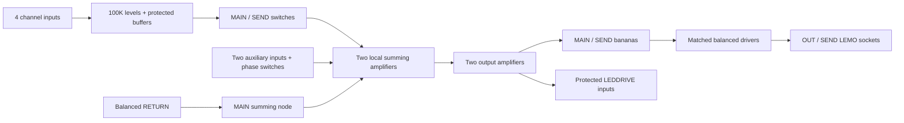

# MIX4 — Mixer v2

Open `Mixer.pcb` in Xcopper. Keep `Balanced.pcb` and `Base/` beside it. The original MIX4 panel and all performance controls are retained. `Mixer_v1` and the shared Base library are unchanged.

The board is 101.6 × 152.4 mm, 1.6 mm thick, with six copper layers: SIG / GND / VCC / VEE / GND / SIG. Coordinates are viewed from the rear/component side. Panel coordinates are mirrored horizontally, with board offsets of 3.175 mm horizontally and 12.7 mm vertically. `MIX4.panel` is the panel reference. SMT parts are on top; pots, switches, LEDs and bananas are on the bottom; cable headers are on top.

## Changes from v1

- One LEDDRIVE module now monitors M_BUS op-amp outputs 1 and 7 through 4K7 protection resistors. The separate monitor, rectifier, envelope and reference circuits are removed. The unused RETURN amplifier is a grounded follower.
- The eleven bus input resistors form two banks beside M_SUM, rather than following their sources across the board. Longer runs carry buffered signals; the shared summing nodes stay local.
- `Balanced.pcb` replaces the cascaded, unequal-gain balanced-output stages. Both legs have matched resistor ratios, matched compensation and 470 Ω series output resistors outside feedback.
- 4K7 input resistors protect all channel wipers, auxiliary polarity inputs, balanced RETURN inputs and LEDDRIVE inputs. Series combinations preserve the intended gains: auxiliary 4K7 + 15K3 = 20K; RETURN 4K7 + 28K3 = 33K.
- Included modules have zero rotation; added passives and ICs retain their horizontal orientations. The fixed internal geometry of Base modules is retained.
- Base dependencies, the v1 notes, a build manifest, resolved netlist, routing geometry and analysis harness are kept in this project.

## Controls and signal flow

Each channel input feeds a 100K linear pot, then a 4K7-protected BUF input. Its NKK switch sends the buffered level exclusively to MAIN or SEND. There is no center mute. Pin 2 is common, pin 1 selects MAIN and pin 3 selects SEND. Pot pin 1 is ground, pin 2 is the wiper, and pin 3 is the input.

AUX SEND and AUX MAIN retain their fixed destinations and exact normal/inverted polarity selection. Auxiliary switch pin 1 grounds the noninverting input for inversion; pin 3 selects normal polarity. Balanced RETURN feeds MAIN independently of the auxiliary phase switch, and never feeds SEND internally.

Nominal banana level is 10 Vpp (±5 V). The unloaded balanced differential gain is 0.33: 10 Vpp at a banana gives 3.3 Vpp between balanced pins 2 and 3, or 1.65 Vpp per leg. RETURN gain is 100/33, restoring 3.3 Vpp differential to 10 Vpp internally. These are linear gains, not limiters; multiple full-scale inputs can clip on the ±12 V supply.

The new balanced outputs deliberately have 470 Ω per-leg source resistance. Differential gain into a resistive load R is approximately `0.33 × R/(R + 940 Ω)`. For example, a 10K differential load gives 0.3016 rather than the unloaded 0.33. Use high-impedance receiving equipment. A receiving MIX4 RETURN also causes a small loading loss; the nominal level convention is unloaded.

## Balanced-driver circuit

Both channels use Base/OP, with 20K/3K3 0.1% resistor networks. The positive leg uses a 20K/3K3 input divider and a noninverting amplifier with the same ratio. The negative leg uses a 20K input resistor and 3K3 feedback resistor. Both positive inputs have matched impedances, and all four 3K3 resistors have parallel 47 pF C0G capacitors. The positive divider and feedback network cancel the extra noninverting gain factor, giving matched transfers:

`H+ = +(3K3 / 20K) / (1 + s × 3K3 × 47pF)`

`H− = −(3K3 / 20K) / (1 + s × 3K3 × 47pF)`

Each cable leg has its own 470 Ω output resistor. This is a symmetric active driver, not a floating/transformer output: grounding one leg does not double the other leg's signal.

## Indicators

LEDDRIVE operates from VCC and GND. Each sense resistor is 4K7; approximately 5 V at a LEDDRIVE input commands 1.06 mA LED current, subject to LED/driver headroom. Negative input voltage is current-limited by the added 4K7 input resistor. LEDs indicate positive-polarity signal activity, including positive DC; they are not full-wave magnitude or clipping detectors. There is no 33 ms envelope filter or offset-reference circuit. Measure brightness, zero-input behavior, negative-input recovery and fast-signal behavior on the prototype.

## Wiring and assembly

All four headers use **right-angle MTA-156-3** parts, with 3.96 mm pitch. Do not substitute vertical headers in the 26 mm enclosure. The native footprint is the common three-hole MTA pattern; confirm the selected angled header's bend direction and mating housing against the case. Header centers and pin numbering preserve v1; pad 1 is rightmost when viewed from this PCB side.

| Header | Center X, Y (mm) | Pin 1 | Pin 2 | Pin 3 |
| --- | --- | --- | --- | --- |
| J_PWR | 76.2, 25.4 | −12 V / VEE | GND | +12 V / VCC |
| J_RETURN | 25.4, 25.4 | GND/shield | RETURN + | RETURN − |
| J_OUT | 25.4, 50.8 | GND/shield | MAIN + | MAIN − |
| J_SEND | 76.2, 50.8 | GND/shield | SEND + | SEND − |

Wire these to the panel-mounted LEMO.1B.303 sockets. Rear-view clearance-hole order is RETURN, OUT, SEND, POWER: four Ø12.5 mm holes at Y=12.7 mm, X=12.7/38.1/63.5/88.9 mm. They are connector clearances, not added PCB mounting holes.

Allow approximately 12 mm from the panel rear face to the PCB's nearest surface, then 1.6 mm PCB thickness. The layout reserves an 8.5 mm radius around each banana center, measured to other component extents. This is an explicit wrench-clearance allowance, not a model of a particular wrench. Check the actual nuts, angled plugs, cable bends and case assembly before ordering the enclosure. The header corridors remain free of added components; insertion/removal is along the open space between connector columns.

Use `assembly.csv` for component ratings as well as the native BOM. All fixed passives are 1206. All ICs are AD823A from Base modules. Feedback/divider resistors in the balanced stages and all RETURN input/feedback resistors are 0.1%. Other resistors are 1% unless specified. Every 470 Ω output resistor must be rated at least 0.5 W. Supply capacitors are 2.2 µF, 50 V X7R; signal capacitors are 47 pF C0G/NP0, 50 V, preferably matched 1% parts in Balanced.

## Reproduction and verification

`tools/build.py` recreates the placement/net-label manifests as `Mixer.unrouted.json` and `Balanced.unrouted.json`. It does not overwrite either routed `.pcb` file. `tools/replay.mjs` reapplies saved native copper to a newly opened unrouted design through an MCP client. `Base/` is a pinned copy of the required shared modules; hashes are recorded in `manifest.json`.

`python3 tools/verify.py` reads Xcopper's resolved `validation/netlist.json` and `validation/layout.json`. It checks 192 channel/phase/level cases, RETURN common-mode response, balanced gain/phase matching with the actual RC networks, output loading, component sides/orientations, banana spacing and absence of via drills in pads. Results are in `validation/verification.json`. Native DRC/connectivity results are saved separately.

The analysis uses finite-gain ideal op amps and nominal components. It does not validate real amplifier frequency response, tolerance-limited common-mode rejection, noise, distortion, stability, clipping recovery, thermal behavior or LED nonlinearity. Prototype checks should cover both buses with bipolar DC, audio, summed overload, representative cable/load combinations, and both balanced legs measured together.

Component references: [AD823A datasheet](https://www.analog.com/media/en/technical-documentation/data-sheets/AD823A.pdf), [TE MTA-156 header family](https://www.te.com/en/product-640385-3.html).
